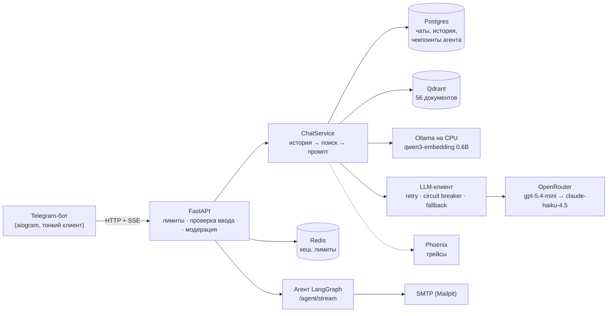

# Финпомощник — AI-ассистент по личным финансам

> **Проверяющему:** указатель по всем 29 ДЗ курса — [SUBMISSION.md](SUBMISSION.md).
>
> **Итоговая аттестация:** видео-демонстрация — _ссылка будет добавлена после записи_ ·
> презентация — _ссылка будет добавлена_ · обоснование решений — [docs/decisions.md](docs/decisions.md).

Дипломный проект курса «ИИ-разработчик: от API до агентов». Один растущий репозиторий: каждое ДЗ модулей 3–6
добавляет слой к одному сервису. Все данные пользователей — **синтетические**.

Что умеет:

- отвечает на вопросы о тратах пользователя (function calling над его операциями) и о курсах ЦБ;
- ведёт диалог с историей (Postgres), понимает фото чеков, PDF и DOCX, голос (при ключе OpenAI);
- отвечает по базе знаний из 56 документов (налоги, вклады, кредиты, мошенничество, FAQ приложения) с цитатами
  и честным отказом, если ответа в базе нет;
- работает через HTTP API (FastAPI, SSE-стриминг) и Telegram-бота;
- защищён от prompt injection (валидатор ввода, canary, фильтр вывода), маскирует персональные данные в логах.

## Сценарии использования

| Сценарий | Пример | Что происходит |
|---|---|---|
| Вопрос о правилах | «Сколько вернут за лечение зубов?» | ответ по базе знаний со ссылкой [1] на документ |
| Уточнение в диалоге | «А сроки какие?» после вопроса о вычете | вопрос переписывается с учётом истории, затем поиск |
| Вопрос вне базы | «Как оформить загранпаспорт?» | честный отказ «по базе не нашёл», без выдумки |
| Расчёт по своим цифрам | «Доход 100 000, расходы 55 000 — сколько остаётся?» | модель считает сама |
| Разбор чека | фото чека или PDF-выписка | позиции и итог, траты по категориям |
| Мошенники | «Звонят из банка и просят код из SMS» | порядок действий по базе + предупреждение не пересылать данные |
| Действие с подтверждением | `POST /agent/stream`: «Найди лимит страхования вкладов и отправь письмом на …» | агент ищет в базе, готовит письмо и **ждёт подтверждения**; после `resume` письмо уходит (видно в Mailpit) |

Подробнее о том, почему выбраны эта область и такое устройство, — [docs/decisions.md](docs/decisions.md).

## Архитектура



Подробная схема со слоями и точками отказа — [docs/architecture.md](docs/architecture.md); граф агента —
[docs/agent-graph.png](docs/agent-graph.png) и [docs/agent-persistent-report.md](docs/agent-persistent-report.md);
качество поиска — [docs/rag_evaluation.md](docs/rag_evaluation.md).

## Запуск

**Нужно:** Docker Desktop (или Docker Engine + compose v2), Python 3.12, [uv](https://docs.astral.sh/uv/), ключ
[OpenRouter](https://openrouter.ai/keys) (ответы модели — центы за десятки вопросов). Ollama — по желанию (см. ниже).

### 1. Настройка (один раз)

```bash
git clone https://github.com/isergeevych/fin-assistant-diploma.git && cd fin-assistant-diploma
python scripts/init_env.py --openrouter-key sk-or-v1-... --no-ollama
```

`init_env.py` создаёт `.env` из `.env.example` и сам генерирует пароли Postgres, Qdrant и служебные токены.
Эмбеддинги базы знаний — два варианта:

- `--no-ollama` — через OpenRouter (`baai/bge-m3`), ничего ставить не нужно;
- без флага — локально в [Ollama](https://ollama.com): `ollama pull qwen3-embedding:0.6b` (так проект и разрабатывался;
  пороги RAG откалиброваны под эту модель).

### 2. Весь сервис в Docker

```bash
docker compose up -d --build     # migrate → ingest (индексация 56 документов) → app, + postgres, qdrant, redis, phoenix, mailpit
docker compose ps                # app: healthy; migrate и ingest: exited (0) — они одноразовые
```

- API и Swagger: http://localhost:8000/docs (порт — `APP_PORT` в `.env`)
- Phoenix (трейсы): http://localhost:6006 · Mailpit (письма агента, ДЗ 6.4): http://localhost:8025
- Проверка: `curl -X POST localhost:8000/rag/query -H "Content-Type: application/json" -d '{"question":"Сколько вернут за лечение зубов?"}'`
- Telegram-бот поднимается, только если в `.env` есть `BOT_TOKEN` (от @BotFather) и `BOT_ADMIN_IDS`; без токена контейнер
  `bot` просто завершается.

### 3. Тесты (без сети и ключей)

```bash
uv sync --extra agents --group dev          # минимум; полный набор: + --extra eval --extra tracing --extra rerank
uv run pytest -q                            # ~230 тестов; с Postgres — если запущен Docker, иначе они пропускаются
```

Без `--extra agents` тесты агентов (6.3–6.4) пропускаются, сервис работает, `/agent/stream` отвечает 503.
Скрипты ДЗ (`scripts/`, `eval/`, `experiments/`) запускаются через `uv run python -m scripts.<имя>`; какой extra
нужен — в шапке каждого скрипта. На Windows в PowerShell: `.venv\Scripts\python` вместо `uv run python`.

**Если что-то не так:** порт 8000 занят — поменяйте `APP_PORT`; `ingest` завершился с ошибкой — `docker compose logs
ingest` (чаще всего недоступна Ollama: используйте `--no-ollama`); кириллица в консоли Windows — `set PYTHONIOENCODING=utf-8`.

## Переменные окружения

Все переменные — в [.env.example](.env.example) с комментариями; `scripts/init_env.py` создаёт из него `.env` и сам
генерирует пароли и токены. **Обязательна** вручную только `LLM__API_KEY`; бот — при `BOT_TOKEN`.

| Переменная | По умолчанию | Назначение |
|---|---|---|
| **Модель** | | |
| `LLM__API_KEY` | — (**обязательно**) | ключ OpenRouter |
| `LLM__BASE_URL` | `https://openrouter.ai/api/v1` | OpenAI-совместимый API |
| `LLM__DEFAULT_MODEL` | `openai/gpt-5.4-mini` | основная модель ответов |
| `LLM__FALLBACK_MODEL` | `anthropic/claude-haiku-4.5` | резерв другого вендора; пусто — без резерва |
| `LLM__LOCAL_BASE_URL`, `LLM__LOCAL_MODEL` | Ollama, `gemma3:4b` | последний резерв — локальная модель; пусто — без него |
| `LLM__REQUEST_TIMEOUT`, `LLM__CALL_TIMEOUT` | 30, 15 с | таймаут HTTP-запроса и дедлайн попытки у одного провайдера |
| `LLM__MAX_RETRIES`, `LLM__MAX_CONCURRENCY` | 3, 5 | повторы на 429/5xx; одновременных вызовов модели на процесс |
| `PROMPT_VERSION`, `PRODUCT_NAME` | `v1`, `Финпомощник` | версия промпта function calling (ДЗ 3.1); имя ассистента в промптах |
| **Сервис** | | |
| `APP_PORT` | 8000 | порт API на хосте |
| `REDIS_URL`, `CACHE_TTL_SECONDS` | `redis://127.0.0.1:6379/0`, 3600 | кеш ответов и лимиты |
| `CORS_ORIGINS`, `LOG_LEVEL` | localhost:3000/8000, `INFO` | |
| `MODERATION_ENABLED` | `true` | модерация входящих (словарь; + OpenAI moderation при `OPENAI_API_KEY`) |
| `ADMIN_TOKEN`, `INTERNAL_TOKEN` | генерируются | `X-Admin-Token` для админских маршрутов; общий секрет app ↔ bot |
| **Чат и история** | | |
| `CHAT_REPOSITORY` | `postgres` | `postgres` или `json` (файлы, без БД) |
| `CHAT_CONTEXT_STRATEGY`, `CHAT_CONTEXT_WINDOW` | `sliding`, 10 | сколько сообщений истории идёт в контекст |
| `LLM_CONTEXT_TOKENS`, `LLM_RESPONSE_TOKENS`, `LLM_SAFETY_MARGIN_TOKENS` | 16000, 1024, 512 | бюджет токенов контекста |
| `POSTGRES_USER`, `POSTGRES_PASSWORD`, `POSTGRES_DB`, `DATABASE_URL` | `fin`, генерируется, `fin` | Postgres (в compose адрес подставляется сам) |
| **Telegram-бот** | | |
| `BOT_TOKEN` | — | токен от @BotFather; без него контейнер `bot` не запускается |
| `BOT_ADMIN_IDS` | — | Telegram ID админов через запятую: админ-кнопки, без лимитов |
| `BACKEND_URL`, `BOT_URL`, `BOT_API_PORT` | — | адреса app ↔ bot (в compose подставляются сами) |
| `STREAM_MODE`, `BROADCAST_POLL_SEC` | `draft`, 15 | как бот показывает поток (`draft` / `edit`); опрос рассылок |
| `OPENAI_API_KEY` | — | только голос → текст (Whisper) и OpenAI moderation; без него голосовые отклоняются |
| **Поиск по базе (RAG)** | | |
| `EMBEDDING_BASE_URL`, `EMBEDDING_API_KEY`, `EMBEDDING_MODEL` | Ollama, `qwen3-embedding:0.6b` | эмбеддинги; `--no-ollama` → `baai/bge-m3` через OpenRouter |
| `EMBEDDING_BASE_URL_DOCKER` | — | адрес эмбеддингов для контейнеров; пусто — Ollama на хосте |
| `EMBEDDING_DIM`, `EMBEDDING_BATCH_SIZE` | 1024, 64 | размерность (должна совпадать с моделью), размер батча |
| `QDRANT_URL`, `QDRANT_API_KEY`, `QDRANT_COLLECTION` | `http://127.0.0.1:6333`, генерируется, `documents` | векторная БД |
| `RAG_ENABLED`, `RAG_TOP_K`, `RAG_SCORE_THRESHOLD` | `true`, 3, 0.35 | поиск по базе в чате; top-K для `/rag/query` (ДЗ 5.3); порог отказа по вектору |
| `RAG_CHUNK_SIZE`, `RAG_CHUNK_OVERLAP` | 512, 64 | нарезка документов, токенов |
| `RAG_LLM_*` | — | отдельная модель для `/rag/query`; пусто — основная |
| **Оценка и трейсы** | | |
| `EVAL_JUDGE_BASE_URL`, `EVAL_JUDGE_MODEL`, `EVAL_JUDGE_API_KEY`, `EVAL_JUDGE_REASONING_EFFORT` | — | судья RAGAS (`scripts/run_eval.py`) |
| `PHOENIX_LLAMAINDEX_TRACING` | `false` | дерево «запрос → поиск → модель» в Phoenix |
| **Агент** | | |
| `AGENT_BASE_URL`, `AGENT_MODEL`, `AGENT_API_KEY`, `AGENT_REASONING_EFFORT` | — | модель агента; пусто — основная |
| `AGENT_PREMIUM_MODEL` | `openai/gpt-5.4` | ответ после замечания критика (ДЗ 6.2) |
| `AGENT_CHECKPOINTER` | `sqlite` (в compose — `postgres`) | где хранится состояние агента: `memory` / `sqlite` / `postgres` |
| `AGENT_DEFAULT_ROLE` | `write-with-approve` | права: `read-only` / `write-with-approve` / `full` |
| `SMTP_HOST`, `SMTP_PORT` | `127.0.0.1`, 1025 | почта агента (Mailpit) |
| **Лимиты на пользователя** | | |
| `USAGE_RATE_PER_MINUTE` | 10 | сообщений в минуту |
| `USAGE_DAILY_USD`, `USAGE_DAILY_TOKENS` | 1.0, 50000 | бюджет в сутки (по Москве); 0 — выключено; админы без лимитов |

## Где какое ДЗ

| ДЗ | Что | Где смотреть |
|---|---|---|
| 3.1 | Function calling | `app/tools/`, `app/llm/client.py`, `examples/run_tool_call.py`, раздел ниже |
| 3.2 | Архитектурный паспорт, ADR, LiteLLM | `docs/architecture.md`, `docs/litellm/` |
| 3.3 | Асинхронный клиент, бенчмарк | `app/services/llm_client.py`, `scripts/benchmark.py` |
| 3.4 | FastAPI-сервис, кеш | `app/main.py`, `app/routers/`, `app/services/llm.py` |
| 3.5 | Docker | `Dockerfile`, `docker-compose.yml` |
| 3.6 | Логи и трейсы | `app/observability/`, `docs/observability/` |
| 3.7 | Тесты и G-Eval | `tests/`, `eval/` |
| 3.8 | Безопасность, garak | `app/services/security/`, `docs/security/` |
| 4.1 | Чат с историей | `app/chat/`, `alembic/`, `docs/chat.md` |
| 4.2–4.4 | Telegram-бот, мультимодальность, модерация, админка | `bot/`, `app/moderation/`, `app/admin/` |
| 5.1 | Эмбеддинги | `app/services/embeddings.py`, `docs/embeddings.md` |
| 5.2 | Qdrant | `app/services/vector_store.py`, `docs/vector_store.md` |
| 5.3–5.5 | RAG: LlamaIndex, чанкинг, re-ranker, ассистент | `app/services/rag.py`, `docs/rag.md`, `docs/chunking_experiment.md` |
| 5.6 | Оценка RAG (RAGAS) | `app/eval/`, `scripts/run_eval.py`, `tests/eval/`, `docs/rag_evaluation.md` |
| 6.1 | Наивный агент | `app/services/agent_naive.py`, `docs/agent-naive-traces/` |
| 6.2 | ReAct + критик | `app/services/agent_react.py`, `docs/agent-react-report.md` |
| 6.3 | LangGraph: custom и prebuilt | `app/services/agent_graph.py`, `docs/agent-graph-report.md` |
| 6.4 | Персистентность и подтверждение человеком | `app/services/agent_persistent.py`, `app/routers/agent.py`, `docs/agent-persistent-report.md` |
| 6.5 | Мультиагент против одного агента | `experiments/`, `docs/multi-agent-report.md` |

## ДЗ 3.1 — прогоны function calling

Модель `openai/gpt-5.4-mini` через OpenRouter, 12–13.10.2026. Два tool: `get_spending_summary` (операции
пользователя; владелец берётся из контекста сервера, в схеме tool его нет) и `get_exchange_rate` (курс ЦБ РФ).
Полный вывод — `docs/tool_calls_run.txt`, JSON-лог шагов — `logs/tool_calls.jsonl`.

| Кейс | Вопрос | Что сделала модель | Раундов | Токенов |
|---|---|---|---|---|
| (а) tool нужен | «Сколько я потратил на кафе в сентябре 2026?» | `get_spending_summary(2026-09-01…30, кафе)` → «11 571,49 ₽, 7 операций, топ: Шоколадница…» | 2 | 1 710 |
| (б) tool не нужен | «Что такое финансовая подушка и какого размера?» | ответила сразу, без tool | 1 | 837 |
| (в) пограничный | «Сколько примерно стоят 100 евро в рублях?» | **пошла за курсом** `get_exchange_rate(EUR)` → «≈ 9 404 ₽ по курсу ЦБ на 13.10» | 2 | 1 559 |
| (г) цепочка | «Траты на путешествия в июле и сколько это в евро?» | два tool подряд → «61 852,28 ₽ ≈ 657,66 €» | 3 | 2 716 |

**Наблюдения**

- В пограничном случае модель предпочла свежие данные ответу «по памяти» — для финансового ассистента это
  правильно: курс из памяти модели устарел на месяцы. Заплатили за это вторым раундом (+1 вызов, ~700 токенов).
- **Арифметика у LLM ненадёжна даже на production-модели:** 61 852,28 / 94,0355 = **657,75 €**, модель написала
  657,66 €. Ошибка 9 центов — мелочь, но в финансовом продукте недопустима. Вывод: расчёты делает код
  (tool возвращает готовую сумму), модель только формулирует. Та же ошибка была на локальной модели в первом
  прогоне (651,47 вместо 651,25 €).
- **cbr.ru не отвечает с зарубежных IP** (прогон шёл через VPN) — первый прогон закончился честным «сервис ЦБ
  недоступен», модель курс не выдумала. После этого добавлен резервный источник: зеркало cbr-xml-daily.ru с тем
  же XML ЦБ; в ответе tool помечено `source: "ЦБ РФ (зеркало …)"`. Если недоступны оба — ошибка уходит модели,
  цикл не падает (тесты `tests/test_tool_call.py`).
- Модель ни разу не попыталась передать `owner_external_id`: его нет в схеме, а лишние поля отсекает
  `additionalProperties: false` — чужие операции через tool не запросить.

## ДЗ 3.3 — sync против async

20 запросов к `gpt-5.4-mini` (полная таблица — `scripts/benchmark_results.md`): последовательно 35,7 с;
async с параллельностью 5 — 7,1 с (×5,0), с 10 — 3,9 с (×9,2). Ускорение почти линейное, потому что запрос
к LLM — это ожидание сети, а не работа процессора: пока ждём один ответ, отправляем остальные. Потолок
задают лимиты провайдера (429), поэтому параллельность ограничена семафором (`max_concurrency`).

«Всё или ничего»: при ошибке в 3-м запросе из 5 `batch_chat` (gather) вернул 4 ответа и ошибку на месте
третьего, `batch_chat_strict` (TaskGroup) отменил остальные через 0,11 с. Первое — для независимых задач
(рассылка), второе — когда без одного ответа результат бессмыслен.

Попутно найдено: в текст ошибки 400 попадал сырой ответ OpenRouter с `user_id` аккаунта — и уходил клиенту
API. Теперь наружу идёт только поле `message` провайдера (тест `test_bad_request_message_hides_provider_account_data`).
