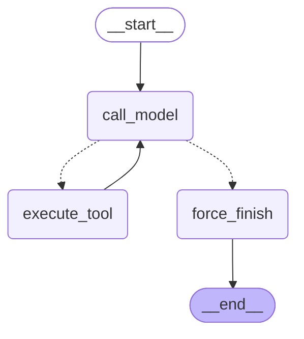

# Агент на LangGraph: custom StateGraph и prebuilt (ДЗ 6.3)

Код — `app/services/agent_graph.py`, тесты — `tests/unit/test_agent_graph.py`, бенчмарк — `scripts/bench_agents.py`
(сырые прогоны — `docs/agent-graph-bench.json`; до исправления из §7 — `agent-graph-bench_v1_sequential_tools.json`).

## 1. Конфигурация

| Параметр | Значение |
|---|---|
| Версии | langgraph 1.2.2, langchain 1.3.2, langchain-core 1.6.10, langchain-openai 1.7.1 (extra `agents`) |
| Модель | `openai/gpt-5.4-mini` через OpenRouter (`ChatOpenAI` с `base_url`), один экземпляр на оба графа |
| Температура | не передаётся: `gpt-5.4-mini` не принимает `temperature` (решение D-10) |
| `MAX_ITERATIONS` | 6 вызовов модели |
| Tools | `search_knowledge_base` (RAG 5.5, top-1 со score-guard), `get_current_time`, `send_telegram_message` (заглушка) — `@tool`, docstring = description, один список для обоих графов |
| System prompt | один и тот же: в custom добавляется в `call_model`, в prebuilt — `system_prompt=` |

## 2. State contract

```python
class AgentState(TypedDict):
    messages: Annotated[list[AnyMessage], add_messages]   # дописывает, а не заменяет
    iteration_count: int                                  # без reducer — замена
    tool_results: Annotated[list[dict], operator.add]     # копит результаты всех шагов
```

- `messages` — вся история диалога; `add_messages` нужен, потому что каждый узел возвращает только **новые**
  сообщения. Без reducer узел `execute_tool` затирал бы историю своими ToolMessage.
- `iteration_count` — сколько раз вызвана модель; reducer «замена» достаточен: пишет только `call_model`.
- `tool_results` — `{tool, args, result[:300]}` по каждому вызову: для отчёта и для `force_finish`, который
  перечисляет собранное, когда лимит исчерпан.
- **В state нет** клиентов, ключей и system-промпта: только сериализуемые данные. Промпт — константа кода, не
  часть диалога; клиент `ChatOpenAI` живёт на уровне модуля. Это условие для checkpointer в 6.4: всё, что
  лежит в state, будет сохраняться в SQLite/Postgres.

## 3. Router и условия остановки

`route_after_model(state) -> Literal["execute_tool", "force_finish"]` — чистая функция: читает state, ничего не
пишет, без сети (тест `test_router_is_pure_and_typed` сверяет `repr(state)` до и после).

1. `iteration_count >= 6` → `force_finish` (стоп-кран — проверяется **первым**, раньше наличия tool_calls);
2. у последнего AI-сообщения есть `tool_calls` → `execute_tool` → обратно в `call_model`;
3. иначе → `force_finish` → END.

`force_finish` в обычном случае ничего не меняет (последний AI-message и есть ответ). Если лимит исчерпан, а
модель всё ещё просит tools, узел **закрывает висящие tool_calls** ToolMessage-заглушками и добавляет явный
итог «Не успел решить задачу за 6 шагов. Собранные данные: …». Проверено тестом на модели, которая никогда
не останавливается, и «сломанном» tool: ровно 6 вызовов модели, 5 результатов в `tool_results`, у каждого
tool_call есть ответ.

## 4. Схема custom-графа



Prebuilt (`docs/agent-graph-prebuilt.mmd`): `__start__ → model ⇢ tools ⇢ model ⇢ __end__` — два узла, без
отдельного финального узла; PNG custom-графа — `docs/agent-graph.png`.

## 5. Бенчмарк: Б6.2 vs custom vs prebuilt

5 задач из 6.2 × 3 реализации × 3 повтора, средние; `react_6_2` — ReAct-цикл из 6.2 **с критиком** (его токены
включены). 13.10.2026, после исправления из §7.

| Задача | Реализация | latency, мс | prompt_tokens | completion_tokens | шагов |
|---|---|---|---|---|---|
| simple_time | react_6_2 | 3 464 | 1 563 | 55 | 2,0 |
| simple_time | custom | 1 985 | 868 | 58 | 2,0 |
| simple_time | prebuilt | 1 965 | 876 | 66 | 2,0 |
| simple_kb | react_6_2 | 5 909 | 2 086 | 110 | 2,0 |
| simple_kb | custom | 6 157 | 1 141 | 135 | 2,0 |
| simple_kb | prebuilt | 5 258 | 1 131 | 134 | 2,0 |
| medium_send | react_6_2 | 8 333 | 3 475 | 169 | 3,0 |
| medium_send | custom | 4 926 | 2 011 | 160 | 3,0 |
| medium_send | prebuilt | 6 158 | 2 016 | 172 | 3,0 |
| medium_days | react_6_2 | 8 295 | 3 119 | 127 | 3,0 |
| medium_days | custom | 5 921 | 1 750 | 140 | 3,0 |
| medium_days | prebuilt | 5 919 | 1 787 | 147 | 3,0 |
| provocation | react_6_2 | 1 284 | 662 | 6 | 1,0 |
| provocation | custom | 756 | 408 | 6 | 1,0 |
| provocation | prebuilt | 761 | 408 | 6 | 1,0 |

| Реализация | latency, сумма 5 задач | prompt | completion | total |
|---|---|---|---|---|
| react_6_2 (с критиком) | 27 285 мс | 10 904 | 467 | **11 372** |
| custom StateGraph | 19 743 мс | 6 178 | 499 | **6 677** |
| prebuilt create_agent | 20 061 мс | 6 218 | 525 | **6 743** |

- Оба графа — **на 41 % дешевле** Б6.2 по токенам: разница почти целиком — критик после каждого шага и
  длинные описания tools в 6.2. Шаги одинаковые: графы — тот же ReAct, только без критика.
- custom и prebuilt по токенам и шагам совпадают в пределах 1 % — это один и тот же алгоритм.
- Латентность — шумная: задача без tools у custom за три прогона заняла 731, 948 и 1 827 мс (первый бенчмарк).
  Разница меньше ~1 с на задачу — не результат; доминируют сеть до OpenRouter и re-ranker на CPU в
  `search_knowledge_base` (~4 с).
- Ответы: на `medium_days` все 27 прогонов дали верные 49 дней (ошибку «414 дней» из 6.1 ни одна реализация
  не повторила).

## 6. Custom vs prebuilt

| | custom StateGraph | prebuilt `create_agent` |
|---|---|---|
| Кода | ~90 строк: state, 3 узла, router, сборка | 1 строка |
| Выполнение tools | писали сами (§7 — сначала последовательно) | `ToolNode`: параллельно, обработка ошибок, валидация args |
| Стоп-кран | явный: `iteration_count` + `force_finish` с понятным итогом | `recursion_limit` графа → исключение `GraphRecursionError`, итог надо оформлять снаружи |
| Свои поля state | `tool_results`, `iteration_count` — где хотим | через `state_schema`/middleware |
| Куда вставить HIL / проверки | любой узел, любое ребро | через middleware и `interrupt` в tool |
| Токены / latency | 6 677 / 19,7 с | 6 743 / 20,1 с |

Вывод по своим числам: по стоимости и скорости разницы нет, значит выбирать по управляемости. **Prebuilt** —
когда агент стандартный «модель ↔ tools»: меньше кода и меньше мест для собственных ошибок (§7 — ровно такая
ошибка была в custom). **Custom** — когда нужны собственные узлы и рёбра: подтверждение перед необратимым
действием, свой финальный ответ при лимите, свои поля state для трейса. Для диплома дальше (6.4: checkpointer
+ human-in-the-loop перед `send_telegram_message`) беру **custom**: там как раз нужен отдельный узел-«шлагбаум».

## 7. Баг, найденный при отладке

**Custom выполнял tool_calls последовательно.** Первый бенчмарк: custom 23,6 с против 17,9 с у prebuilt при
одинаковых токенах. На шаге, где модель просит сразу несколько tools (дата + поиск в `medium_days`), мой
`execute_tool` делал `await tool.ainvoke()` в цикле — по одному; prebuilt `ToolNode` запускает их через
`asyncio.gather` (видно в `langgraph/prebuilt/tool_node.py`). Исправлено: `asyncio.gather` по всем tool_calls
шага; повторный бенчмарк — 19,7 с против 20,1 с.

**Попутно (найдено при проектировании `force_finish`, подтверждено на API):** если граф останавливается по
лимиту, а у последнего AI-сообщения остались `tool_calls` без ToolMessage, следующий запрос с этой историей
API отвергает — `400: No tool output found for function call call_x1` (воспроизведено на `gpt-5.4-mini`).
Без checkpointer это незаметно (история живёт один вызов), но в 6.4 тред сохраняется — и после первого упора в
лимит он был бы сломан навсегда. Поэтому `force_finish` закрывает висящие вызовы заглушками.

## 8. Что блокирует персистентность

- `thread_id` уже передаётся в custom-граф (`config={"configurable": {"thread_id": f"bench-{task}"}}`), но без
  checkpointer это no-op: граф компилируется `builder.compile()` без `checkpointer=`. Подключение — одна строка
  (`compile(checkpointer=AsyncSqliteSaver(...))`), интерфейс вызова не меняется.
- `initial_state()` при каждом вызове сбрасывает `iteration_count=0` и `tool_results=[]`. С checkpointer это
  станет проблемой: на втором сообщении в тот же тред лимит будет считаться заново, а `tool_results` —
  накапливаться бесконечно. Нужно разделить «новый тред» и «продолжение» (передавать только новое сообщение).
- Отправка сообщения — необратимое действие без подтверждения (6.1, задача 06) — нужен `interrupt()` перед ней.
- `search_knowledge_base` синхронный (LlamaIndex + re-ranker на CPU) — в async-графе он уходит в пул потоков;
  при параллельных пользователях это узкое место.
