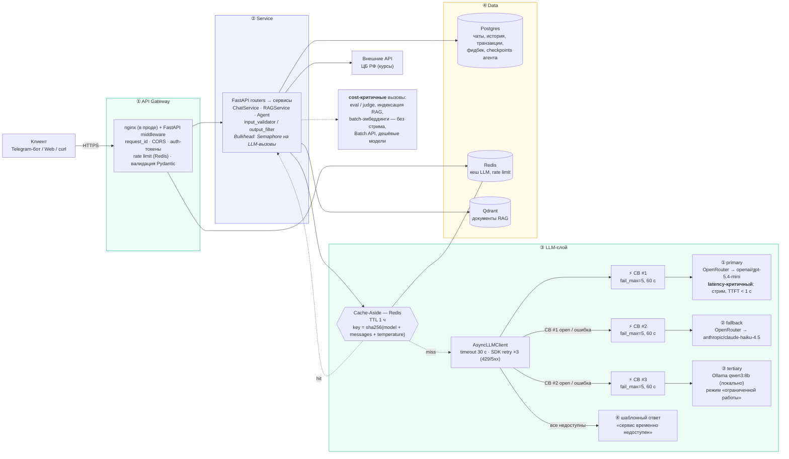

# Архитектурный паспорт: «Финпомощник»

AI-ассистент для анализа личных доходов и расходов. Пользователь общается с ним в Telegram:
спрашивает про свои траты, курсы валют, налоговые вычеты, присылает чеки и выписки.
Документ описывает целевую архитектуру на модули 3–6 и решения, которые её определяют.

## 1. Компоненты и поток запроса

**Поток одного запроса** («Сколько я потратил на кафе в сентябре?»):
клиент → Gateway (request_id, лимит запросов, проверка тела) → Service: валидация ввода на инъекции →
сборка контекста (история из Postgres, при необходимости RAG из Qdrant) → LLM-слой: проверка кеша →
при промахе вызов primary через свой circuit breaker → модель просит tool `get_spending_summary` →
Service выполняет tool (данные из Postgres **только этого пользователя**) → второй вызов модели →
фильтр вывода (утечка промпта, PII) → стрим ответа клиенту → запись в историю.

**Latency- vs cost-критичные вызовы.** Диалог с пользователем — latency-критичный: стрим, быстрая модель,
жёсткие таймауты, fallback вместо ожидания. Оценка качества (LLM-as-judge), индексация документов и
пакетные эмбеддинги — cost-критичные: без стрима, допускают ожидание, отдельный бюджет.

## 2. Нагрузка (ожидаемая, пилот)

| Параметр | Значение | Как получено |
|---|---|---|
| Пользователей в день | ~50 | пилот диплома |
| Пиковый RPM к LLM | 20 | 50 пользователей × ~8 сообщений, пик в 3 раза выше среднего, ×2 на tool-раунд |
| Вход на запрос | 2–4 тыс. токенов | system ~400 + история 10 сообщений + RAG-контекст 3×512 |
| Ответ | 300–500 токенов (2–6 с генерации) | формат «до 4 предложений» + цитаты |
| Пиковый TPM | ~80 тыс. | 20 RPM × ~4 тыс. токенов |
| Бюджет | ~$1/день (≈$30/мес) | 400 запросов/день × (3 тыс. × $0.75 + 400 × $4.5)/1M ≈ $1.6 → ~$1 с учётом кеша и коротких запросов |
| Целевой cache hit rate | 20–30 % | только на общих FAQ; персональные вопросы о тратах в кеш не идут |

## 3. ADR-001: Паттерн взаимодействия — Streaming через SSE

**Status:** Accepted (2026-10-12)

**Context.** Основной сценарий — диалог в Telegram-боте: короткие вопросы о своих тратах, курсах валют и
налогах. Ожидаемая нагрузка — до 20 RPM к LLM в пике, ответ 300–500 токенов, то есть 2–6 секунд генерации,
а с tool-раундом ещё 1–2 секунды. Пользователь сидит в мессенджере и ждёт ответа «вживую». Бюджет — около
$30 в месяц, поэтому лишние вызовы недопустимы. Часть задач фоновая: индексация документов, оценка качества,
рассылки.

**Decision.** Для диалога выбран **Streaming через Server-Sent Events**: FastAPI отдаёт `text/event-stream`,
бот читает поток и обновляет сообщение по мере прихода токенов (`sendMessageDraft` / `editMessageText`
с дросселированием). Для одношаговых вызовов (`POST /chat`, `/rag/query`) остаётся **Request-Response** —
он проще для интеграций и тестов. Фоновые задачи (индексация загруженного документа) идут через
`BackgroundTasks` с ответом 202 — облегчённый вариант Queue без отдельного брокера.

**Consequences.**
- Плюсы: время до первого токена — 0,3–1 с вместо 3–8 с молчания; пользователь видит, что бот работает.
  Если стрим оборвался, накопленный текст всё равно сохраняется в историю.
- Минусы: nginx нужно настроить без буферизации (`proxy_buffering off`, `X-Accel-Buffering: no`);
  соединение держится 5–10 с на пользователя (для asyncio это дёшево); кеш работает только для
  нестримовых ответов или после сборки полного ответа; фильтр вывода проверяет финальный буфер,
  а не каждый токен; ретраить стрим, уже отдавший данные, нельзя.

**Alternatives considered.**
- *Request-Response для чата* — отвергнут: 5–10 секунд тишины в мессенджере выглядят как зависание.
- *Queue-based (Celery/RabbitMQ + polling)* — отвергнут для чата: лишняя инфраструктура и задержка
  поллинга при нашей нагрузке в 20 RPM. Вернёмся к нему, если фоновые задачи начнут конкурировать
  с диалогом за ресурсы.
- *WebSocket* — избыточен: связь односторонняя (сервер → клиент), SSE проще и работает поверх обычного HTTP.

## 4. ADR-002: Стратегия отказоустойчивости

**Status:** Accepted (2026-10-12)

**Decision.**
- **Primary** — `openai/gpt-5.4-mini` через OpenRouter: лучшее соотношение цены ($0.75 / $4.50 за 1M) и
  качества tool calling; контекст 400k.
- **Fallback** — `anthropic/claude-haiku-4.5` через OpenRouter: **другой вендор**, поэтому падение OpenAI
  его не задевает; дороже ($1 / $5), но включается только при сбое.
- **Tertiary** — локальный Ollama `qwen3:8b`: работает, даже если недоступен сам OpenRouter или интернет;
  качество ниже, поэтому ответ помечается как «ограниченный режим».
- **Последний рубеж** — шаблонный ответ без LLM («сервис временно недоступен, ваш вопрос сохранён»).
- **Circuit Breaker — по одному на провайдера**: 5 неудачных запросов подряд → провайдер пропускается
  60 с, затем одна пробная попытка (half-open).
- **Retry**: встроенный в SDK (`max_retries=3`, экспонента с учётом `Retry-After`) — только на 429 / 5xx /
  таймауты; 4xx не ретраятся.
- **Cache-Aside** в Redis: TTL 1 ч, ключ `sha256(model + messages + temperature)`, только для
  неперсональных запросов при `temperature=0`.

**Consequences.** Сервис отвечает и при одновременном падении OpenAI и Anthropic (через Ollama), и при
полной потере сети (через шаблон). Цена: дополнительная поддержка локальной модели (GPU на сервере или
CPU с медленными ответами) и разное поведение моделей. Поэтому промпты и eval прогоняются на primary
и fallback.

## 5. Потенциальные точки отказа

| Слой | Что выходит из строя | Что произойдёт | Что смягчает | Как деградирует сервис |
|---|---|---|---|---|
| ① Gateway | Перегрузка, флуд одного клиента, падение nginx | Отказ всем или «шумный сосед» съедает ресурсы | Rate limit на пользователя/IP, лимиты размера тела, несколько реплик app за балансировщиком | Флудер получает 429 с понятным текстом, остальные работают |
| ② Service | Исключение в обработчике, зависший запрос, исчерпаны соединения | 500, висящие соединения | Bulkhead (Semaphore на LLM-вызовы), таймауты, единый обработчик ошибок, healthcheck/readiness для перезапуска | Вместо traceback — `{"error": {...}}` с кодом; оркестратор перезапускает зависший контейнер |
| ③ LLM | Primary отвечает 429/5xx/таймаут; лежат все облака | Долгие ожидания, ошибки | Retry → CB → fallback-цепочка → Ollama → шаблон; кеш FAQ | Ответ от запасной модели; при полном отказе — шаблон «временно недоступен» + ответы на популярные вопросы из кеша |
| ④ Data: Redis | Нет кеша и rate limit | Промахи кеша, лимиты не считаются | Кеш — fail-open (ошибка Redis = промах), `/ready` → 503, `/health` → 200 | Работает медленнее и дороже, но работает |
| ④ Data: Postgres | Нет истории и транзакций | Нельзя сохранить диалог или посчитать траты | Пул соединений с таймаутом, readiness-проба | Ответ без контекста истории; на вопросы о тратах — «данные временно недоступны», без выдуманных цифр |
| ④ Data: Qdrant | Нет поиска по документам | RAG не находит контекст | Score-guard + честный отказ | «По базе сейчас не нашёл, могу эскалировать»; вопросы о тратах работают |
| Внешний API ЦБ | Курсы недоступны | Tool возвращает ошибку | Таймаут 10 с, ошибка возвращается модели как результат tool | Модель честно говорит, что курс сейчас недоступен, и не выдумывает его |

## 6. LiteLLM как готовый LLM Gateway

Разобрали README LiteLLM и раздел Routing & Fallbacks, локально подняли proxy
(`pip install 'litellm[proxy]'`, без Docker) с конфигом [`docs/litellm/config.yaml`](litellm/config.yaml):
primary → fallback → локальная модель. Протокол эксперимента и логи — в [`docs/litellm/README.md`](litellm/README.md).

**Решение: пишем свой LLM-слой, LiteLLM в дипломе не используем** (пересмотрим, если провайдеров станет больше пяти).
- Курс проверяет собственную реализацию retry / fallback / circuit breaker / async (М2Б3, Б3.3, Б3.4).
  С LiteLLM эта логика ушла бы в чёрный ящик.
- OpenRouter уже работает как агрегатор: один OpenAI-совместимый API ко всем вендорам. LiteLLM поверх
  него добавил бы ещё один сетевой хоп и процесс, который нужно мониторить.
- Плюсы LiteLLM, которые мы признаём: учёт бюджета по ключам, единый формат для 100+ провайдеров,
  готовые fallbacks и балансировка. Это ценно для команды с десятками сервисов, а не для одного бота.

## 7. Как слои реализуются дальше

| Блок | Что добавляется |
|---|---|
| Б3.3 | AsyncLLMClient: Semaphore, таймауты, batch, stream |
| Б3.4 | Слои Gateway и Service на FastAPI, кеш в Redis, доменные ошибки → HTTP |
| Б3.5 | Docker: app + redis, healthcheck, readiness |
| Б3.6 | Observability: Phoenix-трейсы, structlog с request_id, маскирование PII |
| Б3.8 | input_validator / output_filter в Service-слое |
| М4 | Postgres (история чатов), Telegram-бот как клиент Gateway |
| М5 | Qdrant + RAG в Data-слое |
| М6 | Агент (LangGraph) в Service-слое, checkpoints в Postgres |
