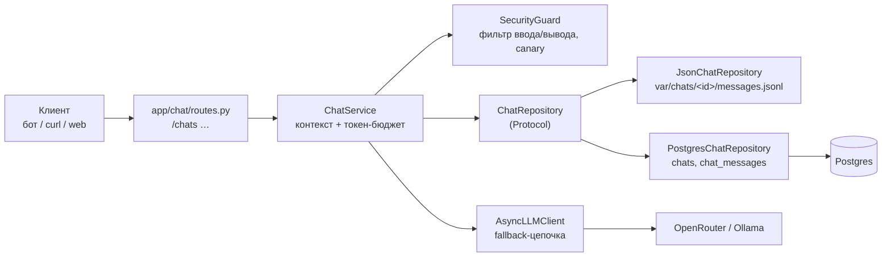

# Чат и история диалогов (Б4.1)

История живёт **на сервере**: клиент (бот, web, curl) присылает только новое сообщение и `chat_id`,
а сервис сам достаёт контекст. Контракт `/chats/{id}/messages` стабилен до конца курса:
поверх него строятся Telegram-бот (М4), RAG (М5) и агент (М6).

## Архитектура



Доменные модели (`app/chat/domain.py`) — только Pydantic. ORM-модели (`pg_models.py`) — отдельно,
граница через `ChatMessage.model_validate(row, from_attributes=True)`.

## Поток `POST /chats/{id}/messages`

1. Чат существует? — иначе **404 до начала стрима** (честный код, а не ошибка внутри потока).
2. Фильтр ввода — иначе **400 до начала стрима**; отклонённое сообщение даже не сохраняется.
3. Сообщение пользователя сохраняется.
4. Загружаются последние `CHAT_CONTEXT_WINDOW` сообщений → system-промпт (+ canary) → окно → **токен-бюджет**.
5. Ответ стримится через фильтр вывода (canary, утечка промпта, PII).
6. Полный ответ сохраняется одним `append_message`. **Если стрим оборвался** (клиент ушёл, сеть) —
   сохраняется накопленное, в логе `chat.stream_interrupted`.

> Найдено на живом стеке: при отключении клиента Starlette отменяет задачу через anyio cancel scope,
> а такая отмена «уровневая» — `await` в `finally` тоже отменялся, и частичный ответ терялся.
> Решение — сохранение под `anyio.CancelScope(shield=True)`. Проверено: обрыв после первых слов →
> в истории `assistant: «Здравствуйте»`.

## Стратегия контекста: sliding window (`CHAT_CONTEXT_WINDOW=10`)

**Почему sliding, а не hybrid (summary + последние M):**
- Вопросы к финансовому ассистенту короткие и почти независимые: «сколько на кафе в сентябре», «курс евро».
  Связь нужна на 1–3 реплики назад («а в августе?»), не на 50.
- Факты о тратах ассистент берёт **из tools и БД**, а не из памяти диалога — суммаризация старой истории
  не добавляет знаний, но добавляет LLM-вызов (деньги и задержку) и риск исказить числа при сжатии.
- Hybrid оправдан для длинных диалогов поиска по документам (вернёмся к вопросу в М5, если RAG-диалоги
  окажутся длинными).

**Токен-бюджет:** `LLM_CONTEXT_TOKENS − LLM_RESPONSE_TOKENS − LLM_SAFETY_MARGIN_TOKENS` = 16 000 − 1 024 − 512.
Окно модели 400k, но бюджет держим маленьким сознательно: длинная история дорогая и почти бесполезна.
Если окно не помещается — `fit_to_budget` режет историю **с начала**, сохраняя system-сообщения и последний вопрос.

**Подсчёт токенов:** `count_tokens(messages)` — tiktoken `o200k_base` (+4 на сообщение, +2 итого).
Сверка с `usage.prompt_tokens` у `gpt-5.4-mini` — _будет добавлена после получения ключа OpenRouter_.

## Хранилища: `CHAT_REPOSITORY=json|postgres`

| | JSON | Postgres |
|---|---|---|
| Где | `${CHAT_STORAGE_DIR}/chats/<id>/chat.json` + `messages.jsonl` | таблицы `chats`, `chat_messages` |
| Запись | append-only, одна строка на сообщение | INSERT |
| Soft delete | строка `{"type": "soft_delete", "at": …}`; при чтении всё до последнего маркера пропускается | `UPDATE … SET deleted_at = NOW()`, строки остаются |
| Последние N | читаем файл, срез `[-N:]` | `ORDER BY created_at DESC LIMIT N` по частичному индексу `WHERE deleted_at IS NULL` → `reversed` |
| Для чего | локальная разработка, тесты | docker compose, прод |

Переключение — одна переменная в `.env`:

```bash
CHAT_REPOSITORY=json        # без БД
CHAT_REPOSITORY=postgres    # нужна миграция: alembic upgrade head (в compose её делает сервис migrate)
```

Оба хранилища проходят **один и тот же** набор контрактных тестов (`tests/chat/test_repository_contract.py`,
Postgres поднимается через testcontainers): 6 сценариев × 2 реализации.

Миграция: `alembic/versions/6bad3440563a_chat_tables.py`. В `alembic/env.py` `include_name` исключает таблицы
LangGraph (`checkpoints*`, Б6.4) — иначе autogenerate предложил бы их удалить.

## Эндпоинты

```bash
# Создать чат (reuse_existing=true — вернуть последний чат этого клиента: идемпотентно для бота)
curl -X POST localhost:8000/chats -H 'Content-Type: application/json' \
  -d '{"owner_external_id":"test-1","interface":"cli"}'
# → {"chat_id":"36498271-8887-4ebd-a7bc-c6df45cc1077"}

# Сообщение → SSE-стрим (data: <кусок> … data: [DONE])
curl -N -X POST localhost:8000/chats/<chat_id>/messages -H 'Content-Type: application/json' \
  -d '{"content":"Привет, меня зовут Аня"}'

# История в хронологическом порядке
curl localhost:8000/chats/<chat_id>/messages?limit=50

# Метаданные чата (404, если нет)
curl localhost:8000/chats/<chat_id>

# Очистить историю (soft delete)
curl -X DELETE localhost:8000/chats/<chat_id>/messages
```

## Проверка критериев (2026-10-12, локальная модель gemma3:4b через fallback)

| Критерий | Результат |
|---|---|
| `docker compose up` с `CHAT_REPOSITORY=postgres` после миграции | migrate → `Exited (0)`, app healthy |
| `POST /chats` → `chat_id` | ✅ |
| Ответ кусками, в конце `data: [DONE]` | ✅ `data: Зд` / `data: р` / `data: авст` … |
| «Привет, меня зовут Аня» → «Как меня зовут?» | ✅ ответ: «Аня.» |
| `GET …/messages` хронологически | ✅ `user, assistant, user, assistant` |
| `DELETE` → пустая история, в БД `deleted_at` проставлен | ✅ 3 строки с `deleted = t` |
| JSON: soft delete отдельной строкой | ✅ тест `test_full_chat_flow` |
| Контрактные тесты на обе реализации | ✅ 12 / 12 |
| `count_tokens` ±10 % от `usage.prompt_tokens` | ⏳ после ключа (у локальной модели другой токенизатор) |
