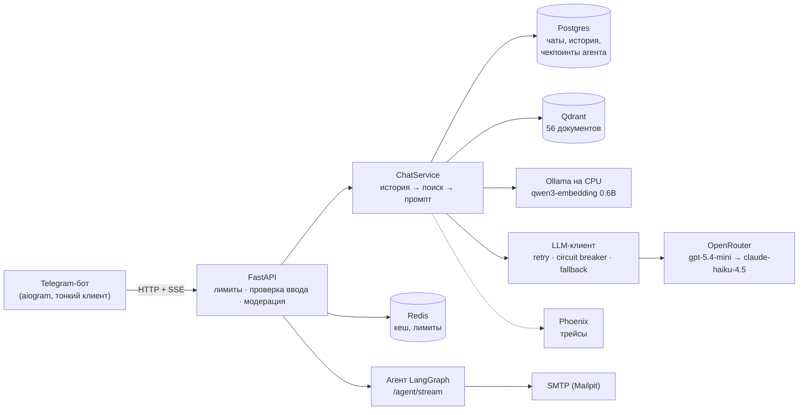

# Итоговое описание решений «Финпомощника»

Обоснование дипломного проекта: почему эта предметная область и почему система устроена именно так. По каждому
решению — что выбрано, из чего выбиралось, почему. Все числа — из отчётов в `docs/` и прогонов в `tests/`; ссылка на
источник дана в каждом разделе. Состояние на 14.10.2026.

## 1. Задача и пользователь

**Пользователь** — взрослый человек без финансового образования, который ведёт личный бюджет в приложении-трекере
(вымышленное приложение «Финпомощник», данные пользователей синтетические). Задаёт вопросы в Telegram — там, где он
и так переписывается, без установки ещё одного приложения.

**Сценарии, которые закрывает система:**

| Сценарий | Пример | Как закрыт |
|---|---|---|
| Вопрос о правилах | «Сколько вернут за лечение зубов?» | ответ по базе знаний со ссылкой на документ |
| Уточнение в диалоге | «А сроки какие?» после вопроса о вычете | история в Postgres, вопрос переписывается с учётом истории перед поиском |
| Расчёт по своим цифрам | «Доход 100 000, расходы 55 000 — сколько остаётся?» | модель считает сама, база не нужна |
| Разбор чека или выписки | фото чека, PDF-выписка | мультимодальная модель, PDF/DOCX → текст |
| Защита от мошенников | «Звонят из банка и просят код из SMS» | ответ по базе + предупреждение не пересылать данные карты |
| Действие с подтверждением | «Найди лимит страхования вкладов и отправь мне письмом» | агент готовит письмо и ждёт «да» человека |

**Почему эта область.** Вопросы о налоговых вычетах, страховании вкладов и мошенничестве задаёт почти каждый, а
ошибка в ответе стоит реальных денег: неверный лимит вычета, совет «перезвоните по номеру из SMS». Правила
меняются каждый год (прогрессивная шкала НДФЛ с 2025 года, ИИС-3, самозапрет на кредиты с 1 марта 2025), поэтому
ответ «по памяти модели» устаревает. Это задача, где ИИ полезен, только если он отвечает **по источникам** и умеет
**честно отказать** — именно это и проверялось весь курс.

## 2. Почему здесь нужен ИИ, а не поиск по словам или FAQ

- **Люди спрашивают не теми словами, что в документе.** «Банк лопнул — что будет с моим вкладом» не содержит слов
  «страхование» и «АСВ». На бенчмарке эмбеддингов англоязычная модель ошиблась на «сколько держать на чёрный
  день» — не связала идиому с «подушкой безопасности» (`docs/embeddings.md`). Поиск по ключевым словам здесь
  промахивается совсем.
- **Ответ часто собирается из нескольких документов.** «Лимит 150 000 ₽ и вычеты за спорт и обучение» — два
  документа и вывод на их стыке; в golden-наборе 21 из 37 вопросов многошаговые (`docs/rag_evaluation.md`).
- **Диалог и свои цифры.** «А сроки какие?» без контекста не найти; расчёт по цифрам пользователя FAQ не сделает.
- **Неструктурированный ввод**: фото чека, PDF-выписка, голосовое сообщение.

При этом ИИ здесь только там, где без него нельзя: короткие реплики («привет», «спасибо», «???») бот отвечает
шаблоном без вызова модели (`bot/services/smalltalk.py`), а правила «вижу только ваши данные» и проверки ввода —
в коде, а не в промпте.

## 3. База знаний

| | |
|---|---|
| Что выбрано | 56 документов: налоги (12), вклады и кредиты (12), бюджет (11), мошенничество и безопасность (10), FAQ приложения (10), 1 заведомо нерелевантный (рецепт борща) |
| Форматы | MD 36, PDF 8, DOCX 6, HTML 6 — чтобы проверить загрузку всех форматов, которые пришлёт пользователь |
| Откуда | собственные краткие пересказы общедоступных правил (НК РФ, правила страхования вкладов, рекомендации Банка России по финансовой безопасности) и FAQ вымышленного приложения; чужие статьи не копировались |
| Особые документы | архивный тариф v1 (249 ₽) и действующий v2 (299 ₽) — проверка фильтра по статусу; рецепт — проверка честного «не знаю» |

**Альтернативы.** Взять готовые статьи с сайтов банков и ФНС — отказались: авторские права и формат (вёрстка,
реклама, дубли). Сгенерировать корпус целиком моделью — отказались: факты нельзя было бы проверить, а оценка
качества имеет смысл только на тексте, в котором мы уверены. Опись — `docs/data_inventory.md`.

## 4. Архитектура

**Путь запроса:** бот → API (лимит частоты и бюджета пользователя, проверка на инъекции, модерация) → история
из Postgres → вопрос переписывается с учётом истории → поиск в Qdrant → промпт с фрагментами → модель через
цепочку провайдеров → фильтр ответа (утечка промпта, персональные данные) → поток токенов в Telegram → запись в
историю. Полная схема со всеми слоями и точками отказа — `docs/architecture.md`.

| Решение | Альтернатива | Почему так |
|---|---|---|
| Бот — тонкий клиент, вся логика в API | логика в боте | один и тот же сервис доступен из бота, Swagger и тестов; бот можно заменить веб-чатом |
| Ответ потоком (SSE) | ответ целиком; WebSocket; очередь | 5–10 с тишины в мессенджере выглядят как зависание; связь односторонняя — WebSocket избыточен; очередь — лишняя инфраструктура при ~20 запросах в минуту (ADR-001) |
| Свой LLM-слой (retry, breaker, fallback) | LiteLLM proxy | подняли LiteLLM и проверили — работает, но OpenRouter уже агрегатор, а LiteLLM добавил бы сетевой хоп и процесс (`docs/litellm/`) |
| Всё в `docker compose` одной командой | ручная установка | проверено на чистом клоне: тесты, весь стек, запуск без Ollama (`--no-ollama`) |

## 5. Выбор модели

| Роль | Выбрано | Альтернативы | Почему |
|---|---|---|---|
| Ответы | `openai/gpt-5.4-mini` через OpenRouter, облако | локальные `qwen3:8b`, `gemma3:4b`; дорогие `gpt-5.4`, Claude Sonnet | надёжный tool calling и русский язык при цене $0,75 / $4,50 за 1M токенов. Локальная `gemma3:4b` с верным фрагментом на первом месте 3 из 3 раз ответила «по базе не нашёл» (`docs/rag.md`); `qwen3:8b` справлялась, но ей нужна видеокарта (см. ниже) |
| Резерв | `anthropic/claude-haiku-4.5` | вторая модель того же вендора | **другой вендор**: сбой OpenAI его не задевает |
| Эмбеддинги | `qwen3-embedding:0.6b` локально (Ollama, CPU) | `bge-m3`, `nomic-embed-text`; облачные | 8/8 на бенчмарке из разговорных вопросов с наибольшим запасом (+0,099 против +0,023 у bge-m3); тексты не уходят внешнему провайдеру; облачный `bge-m3` — запасной путь одним флагом |
| Судья качества | `google/gemini-3.8-flash` | Claude Sonnet | другой вендор, чем у модели ответов; Sonnet в 5 раз дороже и отказывал на промпте судьи (`content_filter`) |

**Почему облако, а не локальная модель целиком.** Проект начинался локально (Ollama, RTX 4070 SUPER 12 ГБ):
`qwen3:8b` в 4-битной квантизации — файл 5,2 ГБ, нужно ~6–8 ГБ видеопамяти. С 11.10 видеокарта начала давать сбои
под нагрузкой (4 аварийные перезагрузки) — генерация переведена в облако, локально остались только эмбеддинги на
CPU. Это же и аргумент против локальной генерации в проде: своя видеокарта — это точка отказа, которую надо
резервировать.

**На каком сервере работает то, что осталось локальным** (замер 14.10, `docker stats` и `ollama ps`):

| Компонент | Память |
|---|---|
| app, bot, Postgres, Redis, Qdrant, Phoenix, Mailpit | ≈ 1,8 ГБ RAM |
| Ollama + `qwen3-embedding:0.6b` (контекст 4096) | 2,4 ГБ RAM, 100 % CPU, видеокарта не нужна |
| **Итого** | ≈ 4,2 ГБ → хватает VPS на 4 vCPU / 8 ГБ RAM без GPU |

Если вернуть генерацию локально: `gemma3:4b` (3,3 ГБ) или `qwen3:8b` (5,2 ГБ) — видеокарта с 8–12 ГБ видеопамяти
(класса RTX 3060 12 ГБ / 4060 Ti 16 ГБ) и 16 ГБ RAM на сервере.

**Стоимость в облаке.** Один вопрос в боте — в среднем 1 438 токенов, $0,00144 (реальная `usage.cost` от
OpenRouter). Все облачные прогоны курса — RAGAS, стресс-тесты, red team, агенты — **$4,64** из бюджета $10. Чтобы
один тестовый пользователь не потратил бюджет, в коде лимиты: 10 сообщений в минуту, $1 и 50 000 токенов в сутки,
админы без лимита.

## 6. Хранение и поиск

| Решение | Альтернативы | Почему |
|---|---|---|
| Qdrant | pgvector в уже имеющемся Postgres | фильтры по метаданным (`status != archived`, даты, категория) в самом запросе с индексами по payload, API-ключ, отдельный сервис в compose (`docs/vector_store.md`). pgvector сэкономил бы один контейнер; на 56 документах разница в скорости не важна — сравнение записано в планы |
| Нарезка `SentenceSplitter` 512 токенов, перекрытие 64 | семантическая нарезка; 256 / 1024 | эксперимент A: семантическая нарезка дала 112 фрагментов вместо 56 и ухудшила поиск (precision −0,037, recall −0,035) без выигрыша в ответах. Документы короткие: 512 токенов ≈ один документ целиком, связный текст не режется |
| top-10 по вектору → re-ranker `bge-reranker-v2-m3` → top-5 | без re-ranker | эксперимент B: средние RAGAS одинаковые, но re-ranker отличает вопросы «не по базе» на порядки (0,0002 против 0,988), и отказ происходит в коде, без вызова модели |
| Двухслойный отказ: порог в коде + правило в промпте | только промпт | на вопрос вне базы модель не вызывается вовсе — нечему галлюцинировать |

Честная оговорка: в Docker-образе re-ranker выключен (torch добавил бы ~700 МБ к образу), поэтому в контейнере
работает векторный порог 0,35, а отказ на «чужих» вопросах держит промпт. Это записано в ограничениях (§10).

## 7. Агентный слой

| Решение | Альтернатива | Почему |
|---|---|---|
| **Один агент** на LangGraph | мультиагент (supervisor + researcher + writer) | сравнили на одних и тех же 5 вопросах: мультиагент — в 2,76 раза больше токенов, в 2,8 раза больше вызовов модели, в 1,7 раза дольше, а качество ниже (faithfulness 0,917 против 0,964): supervisor терял факты при передаче (`docs/multi-agent-report.md`) |
| Свой граф `StateGraph` | prebuilt `create_agent` | нужны свои узлы: подтверждение письма, принудительное завершение по лимиту итераций (6 вызовов модели) с закрытием висящих вызовов инструментов |
| Состояние агента в Postgres | в памяти; SQLite | пауза на подтверждение переживает перезапуск сервиса — проверено `docker compose restart app` посреди паузы |

**Инструменты (3):**

| Инструмент | Что делает | Почему он |
|---|---|---|
| `search_knowledge_base` | поиск по базе знаний | основной источник фактов, без него агент отвечал бы по памяти |
| `get_current_time` | текущая дата и время | вопросы «сколько осталось до…», сроки подачи декларации |
| `send_report_email` | отправка письма | **меняет внешнее состояние** — поэтому только после подтверждения человеком (`interrupt()` → «да»/«нет»), с журналом отправок: повтор со старой точки сохранения не отправит письмо второй раз |

Права определяет сервер, а не клиент: по умолчанию роль `write-with-approve` (каждое письмо — через
подтверждение), `read-only` отправлять не может вовсе (`docs/agent-persistent-report.md`).

## 8. Поведение при сбоях

| Что упало | Что происходит |
|---|---|
| Модель отвечает 429 / 5xx / по таймауту | до 3 повторов с паузой, затем резервная модель другого вендора |
| Провайдер падает 5 раз подряд | circuit breaker: провайдер пропускается 60 с, затем одна пробная попытка |
| Недоступны все провайдеры | локальная `gemma3:4b` через Ollama (если запущена); иначе пользователь получает «Внутренняя ошибка сервиса, попробуйте позже» — без traceback |
| Ошибка «плохой запрос» (400) | резерв не включается — у другого провайдера она повторится |
| Redis | кеш и лимиты работают в режиме fail-open: сервис медленнее, но отвечает |
| Qdrant | честный отказ «по базе не нашёл» |
| API Банка России (курсы) | ошибка возвращается модели как результат инструмента; модель говорит, что курс недоступен, и не выдумывает его |

Проверено: тесты `tests/test_llm_client.py` (переход на резерв, breaker, таймаут) и трейс в Phoenix со всей цепочкой
попыток — `docs/observability/phoenix_trace_fallback.png`.

## 9. Результат: как проверялось качество

| Проверка | Набор | Результат |
|---|---|---|
| RAGAS (ДЗ 5.6) | 37 эталонных вопросов (сгенерированы RAGAS, вычитаны вручную: 5 удалено, 23 исправлено) | faithfulness **0,922**, answer relevancy 0,726, context precision 0,946, context recall 0,973, ссылки на источник в **100 %** ответов; на 35 вопросах по базе context recall = 1,0 |
| Стресс-тест бота | 75 сообщений в 12 категориях, судья — LLM | замечаний 34 → **8** после исправлений |
| Red team | 53 атаки prompt injection: прямые, закодированные, ролевые, через PDF/DOCX/картинку | обходов **0 из 53** |
| garak | сканер уязвимостей, 227 атак | подмена инструкций 20 % → **0 %**, base64 80 % → 2 %, DAN 2,4 % → 0 % (`docs/security/`) |
| Агент: один против нескольких | 5 одинаковых вопросов | см. §7 |
| Автотесты | `pytest -q` | 229 тестов без сети и ключей |

Отчёты: `docs/rag_evaluation.md`, `docs/bot-testing.md`, `docs/security/`, `docs/multi-agent-report.md`.

## 10. Ограничения и планы

| Где система ошибается или отказывает | Почему | Что сделать |
|---|---|---|
| Курс валют в чате не знает | инструмент курса ЦБ есть у агента, но не в чате | подключить `get_exchange_rate` к чату |
| В Docker нет re-ranker | torch +700 МБ к образу; на CPU +4,5 с к ответу | отдельный сервис re-ranker (на GPU ~0,1 с — оценка) или поднять порог после калибровки на живых вопросах |
| Иногда неполные факты (нет даты у самозапрета, МФО без предупреждения о риске) | модель сжимает ответ | правило в промпте «сохраняй оговорки рядом с числами»; расширить эталонный набор |
| Фильтр ввода обходится опечатками и латиницей | регулярные выражения | защиту держит модель; план — нормализовать ввод перед проверкой |
| Модерация — только по словарю | ключа OpenAI нет, `omni-moderation` не включена | включить при наличии ключа |
| Эмбеддинги на CPU — узкое место под нагрузкой | Ollama обрабатывает запросы по одному | при двух параллельных тестах — ответы > 20 с; облачные эмбеддинги или GPU |
| `thread_id` агента задаёт клиент | упрощение для ДЗ | связать тред с аутентифицированным пользователем |
| Агент не подключён к кнопкам бота | в ДЗ достаточно API | кнопки «Отправить / Отменить» в Telegram |

**Что осталось за рамками и почему:** реальные банковские данные (только синтетика — персональные финансовые
данные требуют отдельной правовой базы), индивидуальные инвестиционные рекомендации (бот намеренно отказывает —
это лицензируемая деятельность), голосовые ответы.

## Как выполнена работа

Код писал ИИ-ассистент Claude Code. Постановка задач, выбор между вариантами, проверка результатов и ключевые
решения — мои; подробно — в [SUBMISSION.md](../SUBMISSION.md#как-выполнена-работа).
