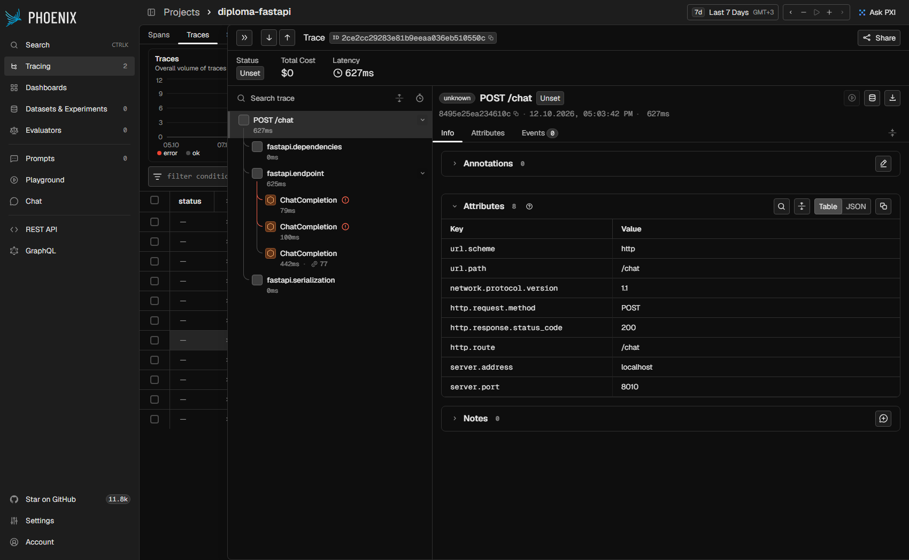

# Observability (Б3.6)

Стек: **Arize Phoenix** (трейсы, UI на http://localhost:6006) + **OpenInference** (автоинструментация
OpenAI SDK) + **structlog** (JSON-логи с `request_id`) + **маскирование PII**.

```bash
docker compose up -d --build        # app + redis + phoenix
open http://localhost:6006          # UI Phoenix, проект diploma-fastapi
```

## Трейс одного запроса



**Что видно на скриншоте** (запрос `POST /chat`, 627 мс, 2026-10-12):
- Корневой спан `POST /chat`, внутри `fastapi.endpoint` и три дочерних спана `ChatCompletion` —
  по одному на каждую попытку LLM-клиента.
- Первые два `ChatCompletion` с красным значком ошибки (79 и 100 мс) — primary
  (`openai/gpt-5.4-mini`) и fallback (`anthropic/claude-haiku-4.5`). В момент съёмки в `.env` стоял
  ключ-заглушка, и OpenRouter отвечал 401.
- Третий `ChatCompletion` успешный (442 мс, 77 токенов) — локальная модель `gemma3:4b` через Ollama.
  Это fallback-цепочка из ADR-002 «вживую»: пользователь получил ответ, хотя оба облачных провайдера отказали.
- Цена `$0`: Phoenix считает стоимость только для известных ему моделей, у локальной её нет.

Как найти такой трейс: Tracing → проект `diploma-fastapi` → фильтр `span_kind == 'LLM'` или поиск по `request_id`.

## Атрибуты LLM-спанов

OpenInference пишет атрибуты по своей семантике: `llm.model_name`, `llm.token_count.prompt`,
`llm.token_count.completion`, `llm.invocation_parameters`, `input.value` / `output.value`.
В задании упомянуты `gen_ai.request.model` / `gen_ai.usage.*` — это конвенции OpenTelemetry GenAI.
Phoenix показывает обе одинаково, в нашей версии инструментора (0.1.65) приходят `llm.*`.
Проверка через REST API Phoenix:

```bash
curl -s "localhost:6006/v1/projects/diploma-fastapi/spans?limit=50"   # спаны ChatCompletion с llm.model_name и токенами
```

## Логи

Каждая строка — JSON. `request_id` берётся из заголовка `X-Request-ID` (только безопасной формы) или
генерируется, кладётся в contextvars и попадает во **все** строки этой цепочки. Пример реальной пары строк
одного запроса (`docker compose logs app`):

```json
{"model": "gemma3:4b", "input_tokens": 74, "output_tokens": 120, "latency_ms": 4360, "finish_reason": "length",
 "cached": false, "stream": false, "prompt_hash": "sha256:cbf4b4cc25ca6b1d",
 "prompt_preview": "Мой email [EMAIL], тел [PHONE_RU], карта [CARD]. Как защитить карту от мошенников? Кратко.",
 "event": "llm_request_completed", "request_id": "demo-pii-15842", "path": "/chat", "method": "POST", ...}
{"status": 200, "duration_ms": 4364.8, "event": "http_request", "request_id": "demo-pii-15842", "path": "/chat", ...}
```

Исходный запрос содержал `ivan@mail.ru`, `+7 (999) 123-45-67` и `4111 1111 1111 1111`.
Поиск по логам контейнера — **0 вхождений** сырых значений.

## Маскирование PII

`app/observability/pii.py`: EMAIL, ACCOUNT (20-значный счёт), CARD, PHONE_RU, INN, PASSPORT.
Применяется в двух местах:
1. явно — `prompt_preview = redact_pii(text)[:120]`, сырой промпт не логируется никогда;
2. страховкой — structlog-процессор `redact_event` прогоняет через маскер все строковые поля любой
   строки лога, включая stdlib-логи библиотек.

Найден и исправлен баг стартер-кода: шаблон `\b(?:\+7|8)…` не находит `+7` после пробела (между пробелом
и `+` нет границы слова), то есть телефон из теста самого задания остался бы в логе. Тест
`tests/test_pii.py::test_course_example_has_no_raw_pii` это фиксирует.

**Важно:** в трейсы Phoenix попадают полные промпты — маскер их не трогает. Поэтому Phoenix слушает
только `127.0.0.1`. Для продакшена — `OPENINFERENCE_HIDE_INPUTS=true` / `OPENINFERENCE_HIDE_OUTPUTS=true`.

Presidio (опциональная часть) не подключали.
