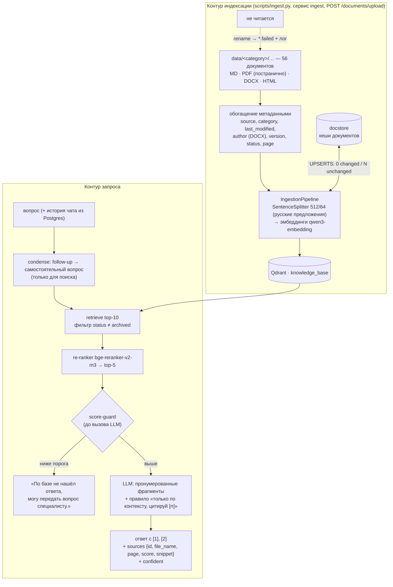

# RAG (Б5.3 → Б5.5)

## Б5.3 — минимальный RAG на LlamaIndex и то же самое руками

### Версии

| Пакет | Версия |
|---|---|
| llama-index-core | 0.14.25 |
| llama-index-vector-stores-qdrant | 0.10.4 |
| llama-index-readers-file | 0.7.0 |
| llama-index-llms-openai-like | 0.8.0 |
| llama-index-embeddings-openai-like | 0.4.0 |
| qdrant-client | 1.19.1 |

LLM подключается через `OpenAILike` (OpenAI-совместимый API): локально — Ollama, в проде — OpenRouter.
Пакет `llama-index-llms-openai` из бандла не подходит: он проверяет имена моделей OpenAI и не знает
`qwen3:8b` / `openai/gpt-5.4-mini` с префиксом провайдера.

### Корпус и коллекция

`data/rag-block-03/` — 10 документов из основного корпуса в 4 форматах (4 PDF, 1 DOCX, 2 HTML, 2 MD + рецепт
борща как заведомо нерелевантный документ).

**Решение по коллекции:** у LlamaIndex отдельная коллекция `rag_block_03`, у bare-metal — `rag_block_03_bare`.
Коллекция из Б5.2 (`documents`) наполнялась через qdrant-client с плоским payload, а LlamaIndex хранит ноды в
своём формате (`_node_content`, `doc_id`, `ref_doc_id`). При подключении через `from_vector_store` к «чужой»
коллекции `source_nodes` пришли бы без текста и метаданных. Параметры совпадают во всех трёх коллекциях:
`qwen3-embedding:0.6b`, размерность 1024, distance COSINE.

### Как устроен `RAGService` (`app/services/rag.py`)

```
SimpleDirectoryReader(input_dir="data/rag-block-03", recursive=True)
  → SentenceSplitter(chunk_size=512, chunk_overlap=64)
  → ServiceEmbedding (адаптер к нашему EmbeddingService: кеш, нормализация, инструкция к запросу)
  → QdrantVectorStore + StorageContext → VectorStoreIndex.from_documents / from_vector_store
вопрос → retriever(similarity_top_k=3) → score-guard → synthesize(text_qa_template) → {answer, top_score, sources}
```

Retrieval и генерация разведены (вместо одного `as_query_engine().query()`): если лучший фрагмент ниже
`RAG_SCORE_THRESHOLD = 0.35`, LLM не вызывается — честный отказ. Индекс создаётся один раз в lifespan FastAPI.
Вся конфигурация (модели, `chunk_size`, `chunk_overlap`, `top_k`, имена коллекций, порог) — в `.env` / `app/config.py`.

### Две находки на отладке

1. **Шум метаданных в контексте.** LlamaIndex по умолчанию подмешивает в контекст LLM `page_label`, полный
   путь `file_path: D:\дз\...`, даты и размеры. Решение — `excluded_llm_metadata_keys` и
   `excluded_embed_metadata_keys` на документах: модель видит только `file_name`.
2. **Размер модели для строгого RAG.** Тот же вопрос «сколько можно вернуть за лечение зубов» с верным
   фрагментом на первом месте (score 0.58): `gemma3:4b` **три раза из трёх** ответила «По базе не нашёл», хотя
   при прямом вызове с тем же текстом отвечала верно. `qwen3:8b` — **три из трёх верно** («до 19 500 ₽ при лимите
   150 000 ₽, для дорогостоящего лечения лимита нет»). Маленькая модель «перестраховывается» правилом отказа.
   Вывод: правило «не нашёл — откажись» требует модели, которая умеет его *не* применять, когда ответ есть.
   Локально — `qwen3:8b`, в проде — `gpt-5.4-mini`.

### LlamaIndex vs bare-metal

| Критерий | LlamaIndex (`rag.py`) | Bare-metal (`rag_baremetal.py`) |
|---|---|---|
| Строк кода (ingestion + query, без импортов) | 44 | 27 |
| Поддержка форматов из коробки | PDF (pypdf), MD, TXT, CSV, изображения — через `SimpleDirectoryReader` | только то, что написали сами |
| Что дописать для PDF/DOCX/HTML | DOCX требует `docx2txt`, HTML читается вместе с тегами и навигацией → свой `BaseReader` | свой `extract_text` (pypdf, python-docx, HTMLParser) — уже был из Б4.3 |
| Что дописать для batch-ingestion / async | есть `IngestionPipeline`, docstore-стратегии (UPSERTS), `aquery` | батчи и идемпотентность — руками (как в Б5.2) |
| Где удобнее дебажить `top_score` / `source_nodes` | `source_nodes` со score есть, но промпт собирается внутри синтезатора — пришлось перехватывать `llm.chat`, чтобы увидеть, что реально ушло в модель | всё на виду: точки Qdrant, промпт из шаблона, ответ |
| Где гибче подменять компоненты (re-ranker, chunker) | node postprocessors (re-ranker), разные NodeParser, response modes — подключаются одной строкой | любой компонент — обычная функция, но каждый пишется самостоятельно |

**Вывод.** Для минимального RAG фреймворк не сэкономил код: адаптер под наш эмбеддер, свой ридер HTML/DOCX
и чистка метаданных съели выгоду (44 строки против 27), а отладка промпта стала сложнее. Но для Б5.4–Б5.5
нужны готовые сплиттеры (Sentence/Semantic), re-ranker как postprocessor, `IngestionPipeline` с UPSERTS и
CitationQueryEngine — писать это руками дольше и рискованнее. **В дипломе остаётся LlamaIndex** как основа
пайплайна, а bare-metal — эталон для проверки: при сомнениях в поведении фреймворка ответ сверяется с прямой реализацией.

### Прогон 5 вопросов (3 хороших / 1 средний / 1 вне базы)

LLM `qwen3:8b` (Ollama), эмбеддинги `qwen3-embedding:0.6b`, top_k=3, порог 0.35. Сырые ответы обеих реализаций —
[`rag_results.md`](rag_results.md).

| # | Тип | Вопрос | Ответ (LlamaIndex) | top-1 source, score | Оценка | Гипотеза |
|---|---|---|---|---|---|---|
| 1 | хороший | Какую сумму вкладов страхует АСВ, если банк лишится лицензии? | 100 %, но не более 1,4 млн ₽ на вкладчика в одном банке | `deposit_insurance_asv.pdf`, 0.820 | релевантно | Формулировка близка к тексту, документ узкий — уверенное попадание |
| 2 | хороший | Звонят из службы безопасности банка и просят код из СМС — что делать? | Положить трубку, сотрудники банка коды не спрашивают, перезвонить по номеру с карты | `fake_bank_security_call.html`, 0.847 | релевантно | HTML-документ после чистки навигации читается корректно |
| 3 | хороший | Сколько стоит тариф Плюс, если платить за год? | 2990 ₽ в год | `tariffs_v2.pdf`, 0.636 | релевантно | В этом корпусе нет архивной v1 — в полном корпусе нужен фильтр по `status` (Б5.2) |
| 4 | средний | Мне лучше сначала досрочно гасить кредит или собрать запас на чёрный день? | Сначала подушка безопасности, затем досрочное погашение, если ставка кредита выше вклада | `early_repayment.docx`, 0.611 | релевантно | Синтез двух документов: «чёрный день» ≠ «подушка» по словам, но эмбеддинги связали — оба документа в top-3 |
| 5 | вне базы | Как оформить загранпаспорт через Госуслуги? | «По базе не нашёл ответа, могу передать вопрос специалисту.» | `tariffs_v2.pdf`, 0.303 | fallback сработал корректно | score ниже порога 0.35 → LLM не вызывалась (а значит, и не могла выдумать) |

Bare-metal-версия дала те же top-1 документы со score в пределах ±0.015 и такие же по сути ответы; на вопросе 5
тоже сработал score-guard (0.287).

**Порог 0.35 — откуда.** На этом прогоне релевантные top-1 — от 0.61 до 0.85, нерелевантные вопросы
(загранпаспорт, погода) — 0.21–0.30. Порог 0.35 лежит в зазоре с запасом с обеих сторон. В Б5.6 его откалибруем
по golden-датасету из 30+ вопросов.

### Проверка через API

```bash
curl -X POST http://localhost:8000/rag/query -H "Content-Type: application/json" \
  -d '{"question": "Какую сумму вкладов страхует АСВ?"}'
# {"answer":"АСВ страхует вклады физических лиц до 1,4 млн ₽ на одного вкладчика…","top_score":0.723,"sources":[…3 шт…]}
```

Проверено в docker compose (2026-10-12): HTTP 200; индекс создаётся один раз в lifespan, при недоступности
Qdrant или эмбеддингов сервис стартует, а `/rag/query` отвечает 503.

---

## Б5.5 — RAG-ассистент на всей базе знаний

### Архитектура: два контура



### Параметры (итог Б5.4 → `app/core/config.py`)

| Параметр | Значение | Откуда |
|---|---|---|
| Чанкинг | `recursive` (SentenceSplitter), 512 токенов, overlap 64 | Б5.4: метрики равны, не режет предложения и числа |
| Retrieval | top-10, фильтр `status ≠ archived` | Б5.2: архивный тариф всплывал первым |
| Re-ranker | `BAAI/bge-reranker-v2-m3`, top-5 | Б5.4: MRR 0.951 → 1.000 |
| Condense | вкл., 1 вызов LLM, `reasoning_effort=none` | без него qwen3 «размышляла» на все 120 токенов и возвращала пустоту |
| Эмбеддинги | `qwen3-embedding:0.6b`, 1024, инструкция к запросу | Б5.1 |
| LLM ответа | локально `qwen3:8b`, прод — `gpt-5.4-mini` | Б5.3: 4B-модель отказывала при верном контексте |

### Порог отказа: два слоя (код + промпт)

1. **Код (score-guard до LLM).** Если работал re-ranker — порог по его оценке `RAG_RERANK_THRESHOLD = 0.1`;
   иначе — по косинусу `RAG_SCORE_THRESHOLD = 0.35`.
2. **Промпт.** «Отвечай только по фрагментам; если ответа нет — „По базе не нашёл ответа, могу передать вопрос
   специалисту“».

**Почему re-ranker, а не вектор, когда он доступен.** Распределение на прогоне:

| Вопрос | Косинус top-1 | Re-ranker top-1 |
|---|---|---|
| «Сколько стоит подписка Плюс за год?» (есть в базе) | 0.607 | **0.967** |
| «Сколько можно вернуть за лечение?» (есть) | ~0.58 | высокий |
| «Как оформить загранпаспорт?» (нет в базе) | **0.370** — выше векторного порога! | **0.0002** |
| «Какая погода завтра?» (нет) | 0.21 | — |

Косинус у «чужих» вопросов на нашем корпусе — 0.21–0.37, у «своих» — 0.58–0.85: зазор есть, но узкий, и
загранпаспорт его пробил. У cross-encoder зазор — четыре порядка (0.0002 против 0.97), поэтому порог 0.1
надёжен с огромным запасом. Без re-ranker (Docker-образ, см. ниже) работает векторный порог 0.35 — в этом
режиме вопрос вроде загранпаспорта отсекает уже второй слой, промпт. Точная калибровка — в Б5.6 на golden 30+.

`confident = true`, если guard пройден и лучший фрагмент ≥ 0.5 по re-ranker (или по косинусу без него).

### Multi-turn

История диалога уже в Postgres (ChatService из М4) и уходит в LLM целиком — поэтому «а сроки какие?» модель
понимает и так. Condense чинит только **поиск**: вектор видит одну строку, а «А сроки какие?» без контекста
ничего не найдёт. Проверено:

| Реплика | Запрос в поиск после condense | Ответ |
|---|---|---|
| «Сколько можно вернуть за лечение?» | (как есть) | «до 19 500 ₽ в год [1]» |
| «А сроки какие?» | «А какие сроки для возврата средств за лечение?» | «проверка до 3 месяцев, по упрощённому порядку ~месяц [2]», источник `tax_refund_timeline.md` |
| «А за учёбу ребёнка?» | (специфичен и так) | «13 % в пределах 110 000 ₽, до 14 300 ₽ [1]» |

### Эндпоинты

| Метод | Путь | Что делает |
|---|---|---|
| POST | `/rag/query` | Одношаговый ответ: `{answer, top_score, confident, sources[{id, file_name, page, score, rerank_score, snippet}]}` |
| POST | `/chats/{id}/messages` | Диалог с RAG: SSE `{"type":"token"}` …, затем `event: sources` с массивом источников, затем `{"type":"done","message_id"}` |
| POST | `/documents/upload` | Загрузка в базу (только `X-Admin-Token`), 202 + индексация в фоне |
| POST | `/chats/{id}/messages/{mid}/feedback` | 👍/👎 + показанные источники (сверяются с сохранёнными в ответе) |

### Проверки (2026-10-12, docker compose)

| Критерий | Результат |
|---|---|
| `python scripts/ingest.py data/` — 50+ документов, 4 формата | 56 файлов (MD 36, PDF 8, DOCX 6, HTML 6), ошибок 0 |
| Повторный запуск | **«0 changed, 56 unchanged»**, записано 0 чанков |
| Битый файл | переименован в `*.failed`, в логе `ingestion.file_failed`, остальные проиндексированы (тест) |
| `POST /rag/query` с цитатами и `confident` | «…1 млн ₽ × максимальная ключевая ставка… [1]», `confident: true`, sources с `page` для PDF |
| Вопрос вне базы | загранпаспорт → отказ, LLM не вызвана (`rag.score_guard` в логе) |
| Multi-turn | см. таблицу выше |
| `POST /documents/upload` с PDF | 202; через ~20 с документ находится и цитируется (страница 1); без токена — 401; имя `../../app/main.pdf` сохранено как `app_faq/main_5201019c.pdf` |
| `docker compose up -d` без ручных шагов | migrate → ingest → app; бот и Qdrant в одном стеке (нужен запущенный Ollama на хосте для эмбеддингов) |

### Две ошибки идемпотентности, найденные на живом стеке

1. **Дубли.** У ingestion на хосте и в контейнере — разные docstore. Контейнерный не знал о документах,
   проиндексированных с хоста, и добавил их второй раз: в коллекции оказалось 112 точек вместо 56, а в `sources`
   один документ шёл дважды. LlamaIndex удаляет старые ноды документа, только если тот есть в *его* docstore.
   Исправление: перед записью изменённого документа удаляем его ноды из Qdrant по `doc_id` сами.
2. **Пустая база при «0 changed».** Коллекцию удалили, а docstore в томе «помнил» все документы и ничего не
   записал. Исправление: если коллекции нет или она пуста, docstore сбрасывается.

После обоих исправлений: docker-ingest 56 → 0 changed; host-ingest со своим пустым docstore — 56 changed, но
в коллекции по-прежнему 56 точек; повтор — 0 changed. Тесты — `tests/unit/test_ingestion.py`.

### Компромисс: re-ranker в Docker выключен

`torch` (+~700 МБ) нарушил бы лимит образа < 500 МБ из Б3.5. В контейнере `RAG_RERANK_ENABLED=false`: поиск
top-10 → top-5 без переранжирования, порог — векторный. Локально (`uv sync --extra rerank`) — полный пайплайн.
Вариант на будущее — отдельный сервис re-ranker с GPU-образом.

### Telegram-бот через RAG

Бот ходит в `/chats/{id}/messages` (SSE), обновляет ответ через `sendMessageDraft` (или `editMessageText` не
чаще раза в секунду — запасной режим), после ответа прикрепляет 👍/👎; источники из `event: sources` бот
запоминает и отправляет вместе с оценкой. Живая проверка — после получения токена бота.
